# Bunkialo

<p align="center">
  <a href="https://bunkialo.noel.is-a.dev/"></a>
</p>

<p align="center">
  <a href="https://play.google.com/store/apps/details?id=com.codialo.Bunkialo2"></a>
  <a href="https://github.com/Noelithub77/bunkialo2/releases/latest"></a>
  <a href="LICENSE.md"></a>
  <a href="https://bunkialo.noel.is-a.dev/"></a>
  <a href="https://github.com/Noelithub77/bunkialo2/stargazers"></a>
</p>

Every IIIT Kottayam portal in one calm app. Bunkialo reads your attendance, works out how many classes you can still skip, and keeps deadlines, your timetable, the mess menu and campus Wi-Fi in one place. **Free, open source, and made by students.**

The name is a question every student asks before class: *bunk* (skip a class) + *cheythalo* (Malayalam for “shall we?”). Say *bunk cheythalo?* fast enough and it becomes Bunkialo.

<p align="center"></p>

## Get Bunkialo

<p align="center">
  <a href="https://play.google.com/store/apps/details?id=com.codialo.Bunkialo2"></a>
  <a href="https://bunkialo.allpyq.in"></a>
  <a href="https://bunkialo.noel.is-a.dev/"></a>
</p>

Android: install from Google Play; the Wear OS app comes with it. iPhone, iPad and desktop: open the web app. On iPhone, tap **Share → Add to Home Screen** to install it. **There is no native iOS app.**

[Website and illustrated tour](https://bunkialo.noel.is-a.dev/) · [All releases](https://github.com/Noelithub77/bunkialo2/releases) · [Privacy policy](.github/PRIVACY_POLICY.md)

## See it in motion

| Dashboard | Attendance | Timetable | Mess |
| --- | --- | --- | --- |
| [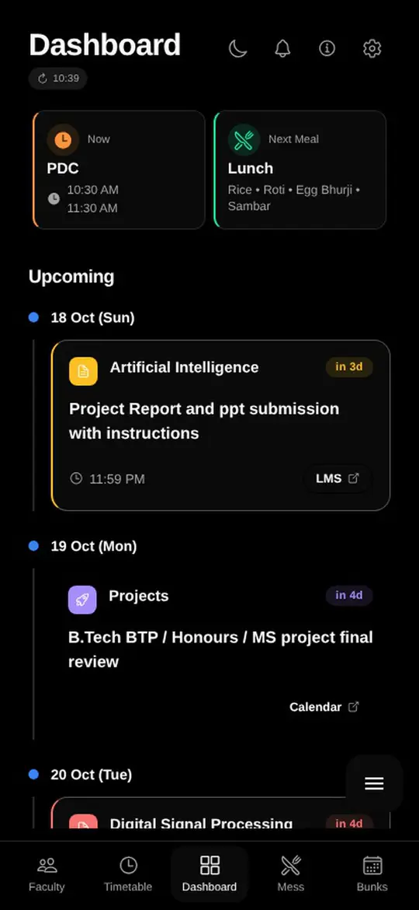](assets/landing/media/dashboard.mp4) | [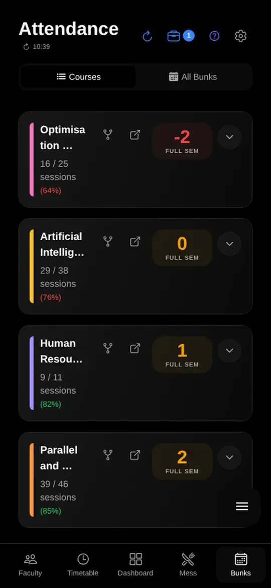](assets/landing/media/attendance.mp4) | [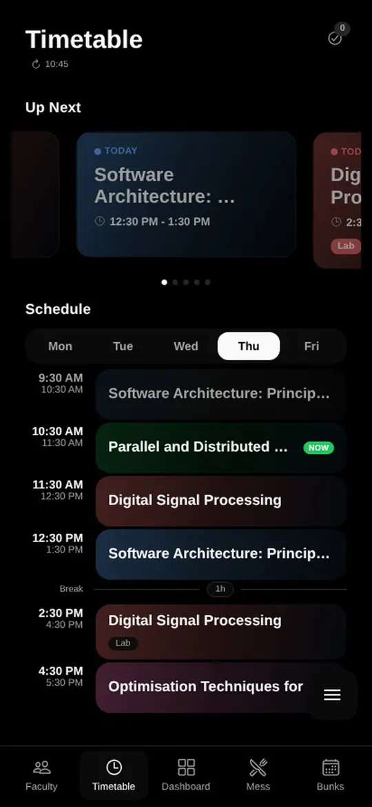](assets/landing/media/timetable.mp4) | [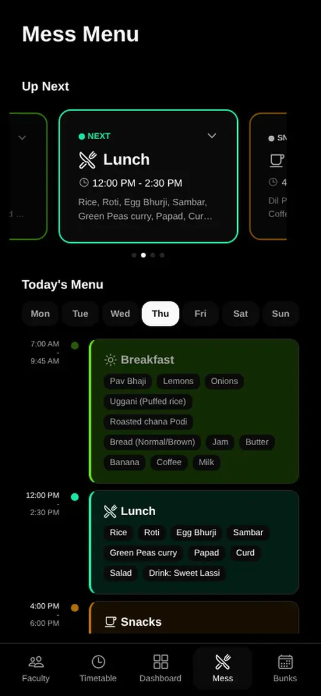](assets/landing/media/mess.mp4) |

| Faculty | GPA | Academic calendar |
| --- | --- | --- |
| [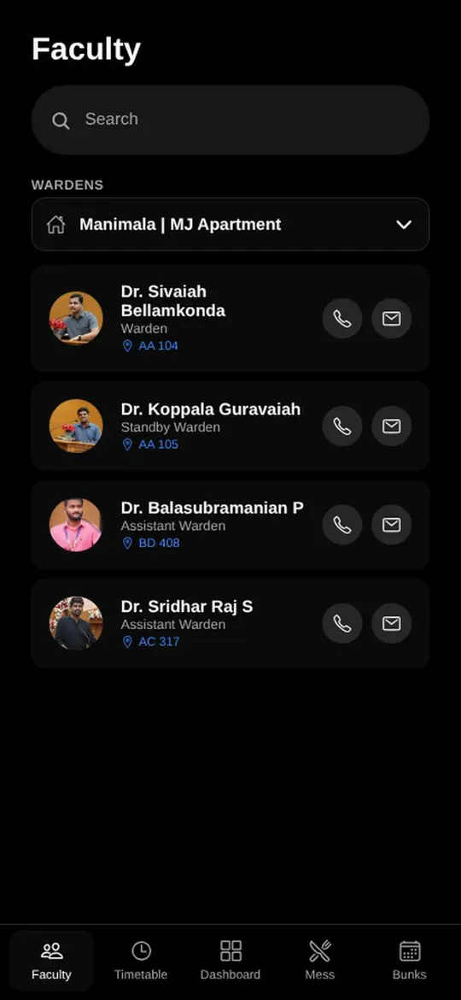](assets/landing/media/faculty.mp4) | [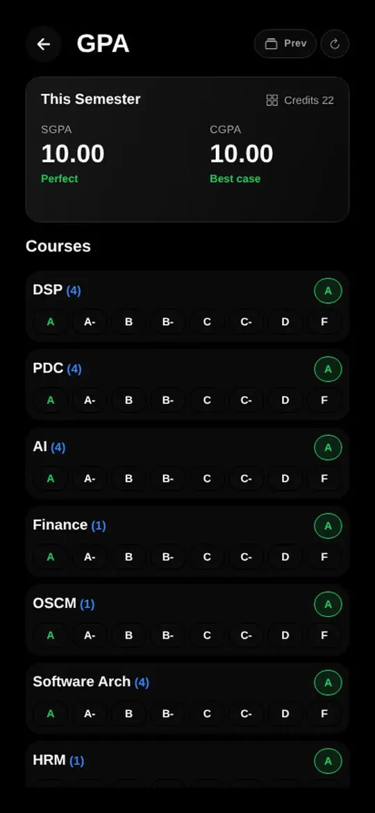](assets/landing/media/gpa.mp4) | [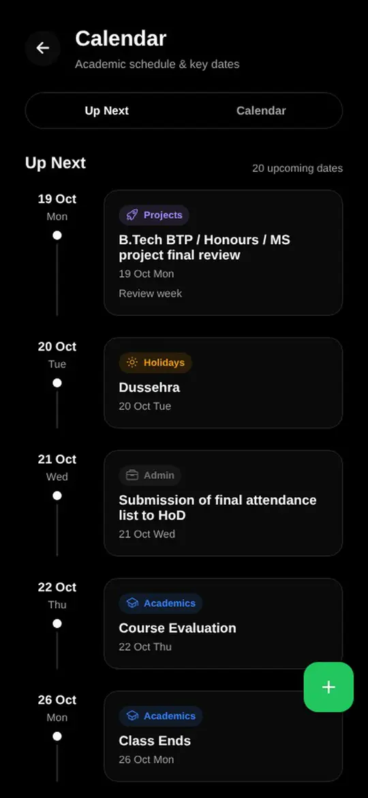](assets/landing/media/acadcal.mp4) |

Recordings use dark mode and demo data. Select a screen to play its recording.

## Every bunk, counted

<p align="center"></p>

Bunkialo reads every absence from the attendance portal, leaves out the ones you mark as duty leave, and shows what's left. Tap the number to switch views: how far you are above the 80% line right now.

**2 × credits + 1** is a rough estimate from repeated calculations, not an official allowance. If the portal marked you absent by mistake, or you were away on duty leave, mark it and the numbers update.

## Every campus portal, together

<p align="center"></p>

Deadlines live on Moodle, attendance on its own portal, the calendar in a PDF and the mess menu on a notice board. Bunkialo signs in once, keeps a copy for when you're offline, and turns it all into the few things you need today.

- **What's next, at a glance.** The class you're in, the next one, the next meal and every upcoming deadline. Reminders arrive before things are due.
- **A timetable that writes itself.** Built from attendance records, so it matches the classes that actually happen. Two-hour slots become labs, and any slot can be fixed by hand.
- **Courses and files.** Browse each course's sections and download protected files without signing in again.
- **Mess, faculty and wardens.** The next meal first, and a typo-tolerant faculty search with hostel wardens.
- **Plan the semester.** SGPA and CGPA from credits and grades, and the academic calendar with export to your own calendar.
- **Home-screen widgets.** Timetable and mess cards on Android.

## WiFix: campus Wi-Fi that signs itself in

<p align="center"></p>

On campus Wi-Fi nothing loads until you log in on a portal page, and it keeps asking again.

1. **Blocked.** WiFix checks whether the internet answers.
2. **Spot the page.** If the request is redirected to the campus login page, it knows why.
3. **Sign in.** It logs in with your LMS username and password.
4. **Online.** It only reports success once the internet actually answers.

WiFix is in the Android app (off until you turn it on; Android checks about every 15 minutes), in the CLI as `wifix`, and in the Omarchy plugin.

## Beyond your phone

| Wear OS | Omarchy plugin |
| --- | --- |
| 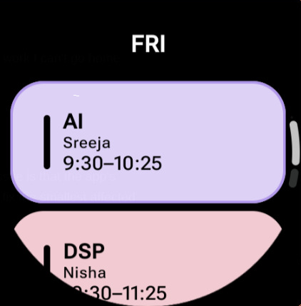 | 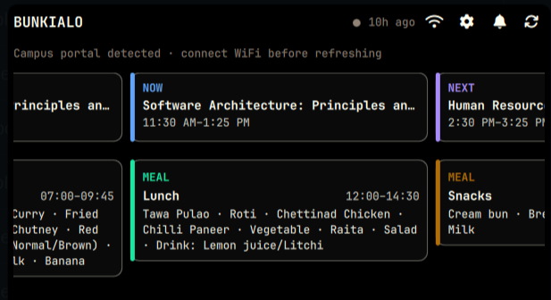 |
| Your next classes and today's menu on your wrist. The phone sends only the timetable, never your login. | The next class, the current meal and a WiFix button, one click from your bar. |

**CLI.** Every portal from your terminal: attendance, deadlines, downloads, submissions and Wi-Fi login. Your password stays in the system keyring.

```sh
# macOS or Linux
curl -fsSL https://raw.githubusercontent.com/Noelithub77/bunkialo2/main/cli/install.sh | sh
```

```powershell
# Windows PowerShell
irm https://raw.githubusercontent.com/Noelithub77/bunkialo2/main/cli/install.ps1 | iex
```

```sh
bunkialo lms recent
bunkialo attendance summary
wifix
wifix status
wifix logout
```

<details>
<summary>Wear OS: timetable sources and builds</summary>

The native Wear OS timetable extension lives in [`wear-os/`](wear-os/). It is a separate Kotlin/Compose app inside this repository, using the same Play Store application ID as the phone app: `com.codialo.Bunkialo2`. Its internal Kotlin namespace remains `com.codialo.bunkialo`.

The watch uses the built-in timetable template by default. A small pen icon at the bottom of each day's timetable opens the timetable editor on the paired phone. From there, the phone can send one of these sources to the watch:

- **Template timetable**: the hard-coded timetable shipped with the Wear OS app (the default).
- **Current account timetable**: the signed-in account's current timetable.
- **Manual timetable**: entries edited directly on the phone.

The phone includes a **Reset to template** action. It removes the phone-supplied timetable and restores the built-in timetable from [`Timetable.kt`](wear-os/app/src/main/java/com/codialo/bunkialo/schedule/Timetable.kt). The watch has the same reset action, so the template stays available without a phone.

The phone and watch talk over the [Wear OS Data Layer](https://developer.android.com/training/wearables/data/overview), and only display data is sent. The watch never receives Moodle credentials, cookies, attendance records or other account secrets. Opening the editor from the watch uses [`RemoteActivityHelper`](https://developer.android.com/reference/androidx/wear/remote/interactions/RemoteActivityHelper), so Bunkialo must be installed on the phone and the watch must be paired.

```bash
cd wear-os
JAVA_HOME=/opt/android-studio/jbr ./gradlew :app:assembleDebug
./scripts/deploy-dev    # connected watch
./scripts/deploy-prod
```

Production deployment needs the signing variables in [`wear-os/AGENTS.md`](wear-os/AGENTS.md). The phone-side editor needs a native Android development or production build with the `wear-timetable` module; it is not available in Expo Go.

</details>

<details>
<summary>Omarchy: install and shortcuts</summary>

Install only the plugin with Omarchy's plugin CLI:

```bash
omarchy plugin add https://github.com/Noelithub77/bunkialo2.git --enable --yes
```

This installs and enables Bunkialo without changing your Hyprland keybindings. For the complete setup, including `SUPER+B`, `SUPER+SHIFT+B`, shell reload and config validation, run the setup script from a clone or directly:

```bash
./scripts/setup-omarchy.sh
curl -fsSL https://raw.githubusercontent.com/Noelithub77/bunkialo2/main/scripts/setup-omarchy.sh | bash
```

The script is idempotent: it installs or enables the plugin, adds the shortcuts once, reloads Hyprland and checks for config errors. See [`omarchy-plugin/README.md`](omarchy-plugin/README.md) for details.

</details>

## Let your agent handle campus

<p align="center"></p>

Add the Bunkialo skill and CLI, and your coding agent can work every IIIT Kottayam portal for you: read attendance, find deadlines, download files, submit assignments and log in to Wi-Fi.

```sh
npx skills add Noelithub77/bunkialo2 --skill bunkialo-academic-portals --global
```

Then just ask:

> Check my attendance and find me the best way to compensate with duty leaves based on nearby events

> Tell me all the assignments that are yet to be done

> Do I have any quiz nearby?

## Build and contribute

You need Node 24.3+, Bun and the Expo CLI.

```sh
git clone https://github.com/Noelithub77/bunkialo2.git
cd bunkialo2
bun install
cp .env.example .env
bunx expo start
```

Android is the only native target; iPhone and iPad use the web app. Read [`AGENTS.md`](AGENTS.md) for the project layout and conventions, and [contributing](.github/CONTRIBUTING.md) before opening a pull request.

<details>
<summary>Checks and test scripts</summary>

```sh
bun test                # unit tests against app modules
bun run lint
bunx tsc --noEmit
```

Live LMS checks need `LMS_TEST_USERNAME` and `LMS_TEST_PASSWORD` in `.env`:

```sh
bun run test:lms-scraper
bun run test:dashboard
bun run test:resources
bun run test:downloads
bun run test:assignment
bun run test:assignment-submit   # uploads only with explicit --submit
bun run test:e2e:assignment
bun run test:e2e:feedback
```

</details>

<details>
<summary>Web app on Cloudflare</summary>

Use the Cloudflare `cf` CLI for web development, build checks and deployment. `bun install` installs the pinned CLI and its build runtime. The Worker configuration is in `cloudflare.config.ts`; `wrangler.config.ts` only sets the Wrangler build tool's static asset directory. Generate Worker types with `bun run worker:types`, or run `bun run worker:typecheck` to generate them and type-check the Worker.

```bash
bun run web:build
bun run worker:check
bun run worker:deploy
```

Deployments need Cloudflare authentication through `cf auth login`, or `CLOUDFLARE_API_TOKEN` and `CLOUDFLARE_ACCOUNT_ID`. The account must own the `allpyq.in` zone to serve `https://bunkialo.allpyq.in`.

</details>

<details>
<summary>Android builds, previews and data refresh</summary>

Download the latest Android development APK from [releases](https://github.com/Noelithub77/bunkialo2/releases), install it, and open the EAS Update preview link from a manually started preview run.

Android build and OTA publish workflows are started by hand from **Actions → Run workflow**. The CLI release workflow runs automatically for CLI changes pushed to main. Start EAS previews with `bunx eas-cli workflow:run .eas/workflows/manual-preview.yml`; the run publishes to `manual-preview-dev` and `manual-preview-expo-go`.

**Faculty and hostel wardens.** The Faculty tab defaults to the Manimala & MJ Apartment wardens; hostels sharing the official roster appear together. The selected group is saved locally and survives restarts, OTA updates, app upgrades and logout. `bun run fetch-faculty` refreshes faculty and hostel data from IIIT Kottayam's official pages. **Refresh Faculty and Hostel Wardens** runs on the first of each month at 00:15 UTC, or manually, and commits changed data to main. For protected main, configure `FACULTY_UPDATE_TOKEN`; otherwise the workflow uses `GITHUB_TOKEN`. It does not publish an app update.

</details>

<details>
<summary>Home-screen widgets</summary>

SDK 58's Expo Widgets powers small timetable and mess cards, with previous/next buttons, page dots, bullet-list dishes, and light and dark mode. Native home-screen widgets do not support swipe carousels.

Timetable snapshots update after schedule or course changes, after hydration, on foregrounding and on sign-out. Only display data is shared with the widgets. Android schedules inexact alarms at weekly class and meal boundaries with a 30-minute system refresh fallback; Doze can delay refreshes.

Widgets need a native build for runtime `1.4.1-sdk58-widgets-v1` or later; Expo Go and older builds cannot show them. Run `bun run test:widgets` after `bunx expo prebuild --no-install` to verify the compiled layouts and paging. The tracked Expo Widgets patch supplies the `memo` stub Expo UI 58 needs during Android runtime initialization.

</details>

<details>
<summary>Landing page and README art</summary>

The website in [`bunkialo-landing/`](bunkialo-landing/) is a static Vite and TypeScript page with GSAP motion and rough.js sketches:

```sh
cd bunkialo-landing
bun install
bun run dev        # http://127.0.0.1:4173
bun test
bun run build
```

The animated SVGs in this README are exported from the landing page's own scenes, with Nunito and Excalifont subsets embedded. After changing a scene, rebuild, serve the page and regenerate them:

```sh
bun run build && bunx vite preview --port 4180 &
bun scripts/readme-art.ts
```

See [`bunkialo-landing/README.md`](bunkialo-landing/README.md) for media and deployment.

</details>

[Report a bug](https://github.com/Noelithub77/bunkialo2/issues/new?template=bug_report.yml) · [Suggest a feature](https://github.com/Noelithub77/bunkialo2/issues/new?template=feature_request.yml) · [Security policy](.github/SECURITY.md) · [Code of conduct](.github/CODE_OF_CONDUCT.md)

## If Bunkialo helped you, even once

Consider [dropping a star on GitHub](https://github.com/Noelithub77/bunkialo2/stargazers). It takes a second, it makes our day, and it helps the next student find it.

Made by Noel Georgi. Ideas by Srimoney and Niranjan V.

## License

Bunkialo is licensed under the **GNU AGPL v3**; see [`LICENSE.md`](LICENSE.md). Fonts and dependencies keep their own licenses and attribution.
